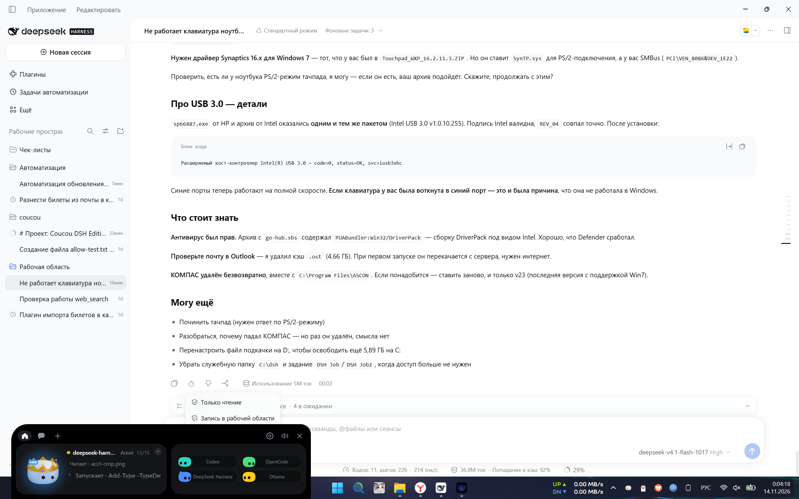

# Шаги 10–11: установщик и установка

**Дата:** 2026-11-14  
**Точка отката:** `c62cec872866c3759d9602995bbe48d7a10f55b4`

## Найденный дефект: незакрытое правило CSS

Сборка выдала предупреждение:

```
[esbuild css minify] Expected "}" to go with "{" [css-syntax-error]
   3782 │ body.place-top-right #island { transform-origin: right top; }
```

Баланс скобок в `src/style.css`: **537 открывающих, 536 закрывающих**. Правило
`.approval-note` осталось незакрытым — блок позиционирования острова был вставлен
внутрь него.

Последствие: все правила начиная с
`.approval-note` попадали **внутрь** него как вложенные, то есть не применялись.
Позиционирование работало только потому, что `applyGeometry` дублирует его
инлайново; а `transform-origin` для анимации задаётся **только** в CSS, поэтому
анимация раскрытия шла не от того края.

Исправлено: `}` возвращён на место, баланс 537/537, предупреждение ушло.
Сборка зеркала ловит это предупреждением — стоит на него смотреть.

## Установщики

Штатный путь репозитория: `npm run pack`.

```
windows/release/Coucou-Windows-0.5.9-setup.exe   12 086 160
windows/release/Coucou-Windows-0.5.9.msi         22 462 464
```

NSIS, `installMode: currentUser`, языки English/French, хук удаления из
`nsis/hooks.nsh` (он чистит `bin`, `inbox`, `coucou.log`, но **не** `dsh\` —
плагин моста переживает удаление).

Убраны предупреждения сборки в моём коде: `UPSTREAM_REPO` и `grows_up` теперь
`#[cfg(test)]`, `SNAP_PX` и `MODULES` удалены как неиспользуемые. Остались только
поля протокола, которые держит исходный код.

## Установка

```
Coucou-Windows-0.5.9-setup.exe /S     → exit 0
```

Проверено после установки:

| Что | Результат |
|---|---|
| файлы | `%LOCALAPPDATA%\Coucou\coucou.exe` 33 143 296, `coucou-hook.exe`, `uninstall.exe` |
| запись деинсталлятора | `Coucou 0.5.9` |
| автозапуск | `Coucou` → `...\coucou.exe --autostart` (создан приложением при первом запуске) |
| `dsh\` | на месте, плагин моста сохранён |
| настройки | унаследованы от оригинала (`%APPDATA%\Coucou\settings.json`) |

`CoucouDshBridge` в автозапуске отсутствует — старый мост не вернулся.

## Приёмка на установленной копии

```
00:02:06 dsh: connected (version 0.2.2-rc.1, approvals on, 9 session(s))
00:02:07 fullscreen watch: covered=false waiting=false screens=1
```

| Проверка | Результат |
|---|---|
| подключение к DSH | есть, 9 сессий |
| пилюля DSH в острове | `deepseek-harness`, шаги 15/15 в реальном времени |
| клик разворачивает остров | да |
| RDP во весь экран | остров скрыт (`covered=true`), после закрытия вернулся |
| автозапуск | ключ создан |



## Тесты

`cargo test --release -p coucou` — **632 passed, 0 failed, 6 ignored**  
`npm test` (в рабочем репозитории) — **588 / 588**, `tsc` чисто.

В зеркале 7 фронтенд-тестов падают: там нет `NotchBuddy/` и `docs/`, от которых
они зависят. Это свойство зеркала, не регрессия; в рабочем репозитории проходят.

## Чего не проверил

- **Карточку подтверждения на установленной копии** — чтобы её увидеть, нужен
  реальный запрос разрешения; специально его не вызывал.
- **Обновление приложения** — источники переведены на форк, но релизов там нет,
  поэтому проверить «нашёл обновление» нечем.
- **Удаление установленной копии** через `uninstall.exe` — не запускал, чтобы не
  сносить рабочий мост.
