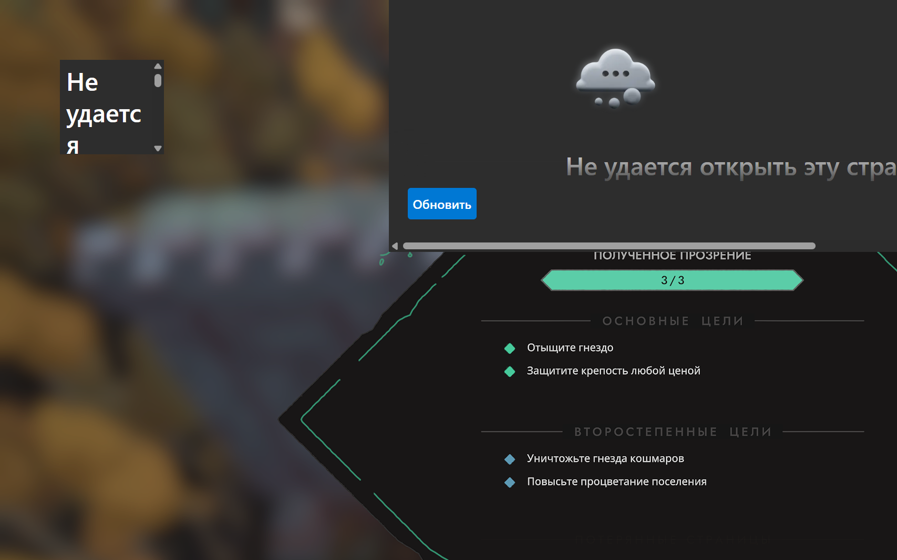
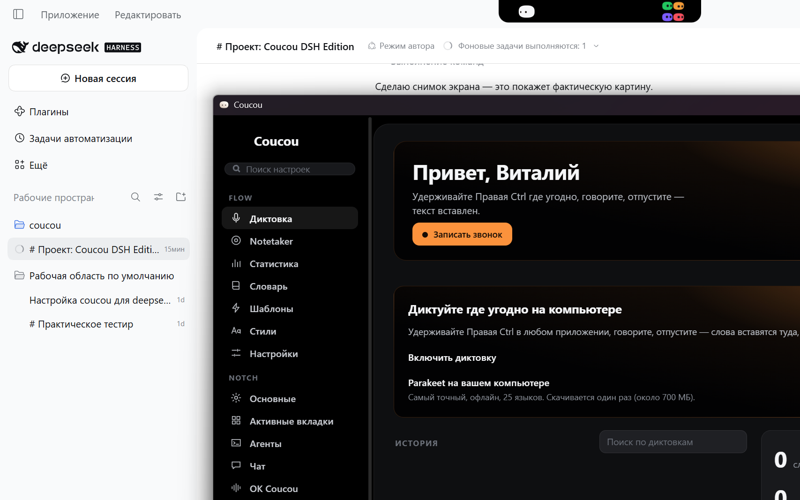

# Исправление: окно Coucou показывало «Не удаётся открыть эту страницу»

**Дата:** 2026-11-12  
**Статус:** исправлено и проверено. Причина была в процедуре сборки, не в коде DSH.

## 1. Симптом

Тестовая сборка запускалась, процесс был жив, DSH подключался — но в окне вместо
интерфейса WebView2 показывал страницу ошибки с кнопкой «Обновить».



## 2. Диагностика

| Проверка | Результат |
|---|---|
| Логи Coucou (`%LOCALAPPDATA%\Coucou-dsh-test\coucou.log`) | ошибок нет: `dsh: connected (version 0.2.2-rc.1, approvals on, 1 session(s))` |
| `dist/` в каталоге сборки | на месте: `index.html`, 4 html-файла, `assets/*.js`, `*.css` (свежие, 02:31) |
| `vite build` | успешно, ассеты с хэшами |
| Конфигурация Tauri | `frontendDist: "../dist"`, `devUrl: "http://localhost:1420"` |
| Встроен ли фронтенд в бинарник | **нет** |
| Размер бинарника | тест: 29 797 376 Б, установленный Coucou: 32 927 744 Б |

Ключевая проверка — поиск имён ассетов внутри `.exe`:

```
test     : island-*.js = НЕТ
installed: island-*.js = ЕСТЬ
```

Символ `index.html` в тестовом бинарнике был, но он приходит из конфигурации, а не
из встроенных ассетов. То есть приложение не содержало ни одной страницы.

## 3. Причина

Tauri решает «dev или production» по **feature-флагу крейта**, а не по профилю:

```rust
// tauri-2.12.0/src/lib.rs
pub const fn is_dev() -> bool {
  !cfg!(feature = "custom-protocol")
}
```

```rust
// tauri-2.12.0/build.rs
let dev = !custom_protocol;
alias("dev", dev);
```

Флаг `custom-protocol` добавляет **CLI `tauri build`**. Сборка шла обычным
`cargo build --release -p coucou`, поэтому:

1. `tauri::is_dev()` = `true`;
2. ассеты фронтенда **не встраиваются** в бинарник;
3. WebView открывает не встроенную страницу, а `devUrl` — `http://localhost:1420`;
4. dev-сервера нет → «Не удаётся открыть эту страницу».

Код DSH (подэтапы 3А и 3Б) к ошибке отношения не имеет: подключение к bridge
работало всё это время, падала только загрузка страницы.

## 4. Исправление

Сборка теперь идёт как production-сборка:

```powershell
cargo build --release -p coucou --features tauri/custom-protocol
```

Изменён файл `windows/scripts/dsh-test-build.ps1` — команда сборки приложения
получила `--features tauri/custom-protocol`, с комментарием почему.

## 5. Проверка после исправления

| Проверка | До | После |
|---|---|---|
| Встроенные ассеты в `.exe` | нет | `island-*.js`, `island-*.css`, `engine-*.js` найдены |
| Размер бинарника | 29 797 376 | 30 252 032 (+455 КБ сжатых ассетов) |
| Окно Coucou | страница ошибки | полноценный интерфейс |
| Логи | без ошибок | без ошибок |
| DSH Bridge | подключён | подключён, `1 session(s)` |



На снимке: интерфейс Coucou загрузился полностью (настройки, разделы Flow/Notch,
приветствие), остров отрисован сверху по центру.

## 6. Что осталось непроверенным

Остров на снимке **свёрнут**: пилюля `dsh` живёт в раскрытом виде, а раскрыть его
в автоматическом режиме не удалось — клик по координатам острова перехватывает
окно DSH. Что видно точно: `State.tasks` получает задачу DSH (код на месте,
событие приходит), но кадр раскрытого острова с пилюлей нужно увидеть вам.

## 7. Оригинальный Coucou

Не изменялся: `settings.json` — тот же SHA-256 `6796C2DE…E86D60` и та же дата
изменения; 22 файла в `%LOCALAPPDATA%\Coucou`; ключи автозапуска `Coucou` и
`CoucouDshBridge` без изменений.