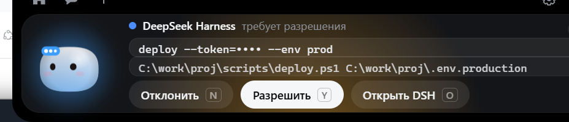

# Приоритет 3, подэтап В: карточка разрешений

**Дата:** 2026-11-12  
**Статус:** реализовано и проверено сквозным прогоном на живом канале.

## 1. Что сделано

DSH-запрос разрешения теперь доходит до острова и выглядит как обычная карточка
Coucou, с тремя ответами.

| Файл | Изменение |
|---|---|
| `src/core/dsh.ts` | `redact()`, `approvalCard()`, `routeFor()` — маскирование секретов, сборка карточки, выбор канала для ответа |
| `src/island/dsh.ts` | `syncApprovals()`: карточка, `ack`, очередь, защита от повторного показа |
| `src/island/island.ts` | клики `decide` / `answerInTerminal` идут по маршруту запроса |
| `src/views/views.ts` | третья кнопка «Open DSH», строка файлов, подсказка со всем списком |
| `src/core/state.ts` | `ApprovalInfo.source` и `ApprovalInfo.files` |
| `src/core/bridge.ts` | `dshApproval()`, `dshApprovalAck()` |
| `src/style.css` | `.code.dsh-files` |
| `src/i18n/extra.json` | «Open DSH» на 14 языках |
| `src-tauri/src/dsh/client.rs` | `take_pending()` — защита от двойного ответа, вынесена под тест |

## 2. Правила безопасности в коде

1. **Сначала карточка, потом `ack`.** Если показать нечего, `ack` не отправляется,
   и DSH задаёт свой вопрос сам.
2. **Пауза острова** отправляет `open`, а не делает вид, что кто-то смотрит.
3. **Rust снимает запрос из очереди до отправки ответа.** Второй клик не может
   ответить дважды.
4. **Остров помнит отвеченные id**, поэтому повторно присланный список не
   возвращает карточку.
5. **Без живого канала и без `approvalsEnabled` карточка не появляется вообще.**
6. **Секреты маскируются** в командной строке до показа.

## 3. Сквозная проверка

Проверялось на подставном мосте (`windows/tools/fake-bridge.mjs`) — он говорит
по тому же протоколу через настоящий именованный канал, поэтому Coucou
подключается к нему ровно так же, как к настоящему плагину.

### 3.1 Карточка появляется и подтверждается

```
recv: {"t":"hello","protocol":1,"token":"…","client":"coucou"}
sent approval.asked
recv: {"t":"approval.ack","requestId":"req-1"}
```

`ack` ушёл — значит карточка реально отрисована, а не просто получена.



В карточке: имя агента, строка «требует разрешения», команда
`deploy --token=•••• --env prod` (токен замаскирован), файлы
`…\scripts\deploy.ps1` и `…\.env.production`, три кнопки.

### 3.2 Allow once разрешает только этот вызов

```
recv: {"t":"approval.answer","requestId":"req-1","decision":"allow"}
```

Ровно один кадр на один запрос.

### 3.3 Deny отклоняет только этот вызов

```
recv: {"t":"approval.answer","requestId":"req-1","decision":"deny"}
```

### 3.4 Open DSH отдаёт вопрос штатному диалогу

```
recv: {"t":"approval.decline","requestId":"req-1"}
```

Это не ответ, а отказ от ответа: плагин передаёт вопрос в `next()`, и DSH
показывает своё окно.

### 3.5 Таймаут ничего не разрешает

Запрос висел 25 секунд без клика:

```
ANSWER frames: 0
DECLINE frames: 0
pings still flowing: 8
```

Ни одного кадра с решением. Клиент Rust не имеет таймера, который отвечает;
единственный таймаут — в плагине, и он возвращает вопрос в DSH.

### 3.6 Отключение Coucou возвращает вопрос в DSH

Убили процесс при висящем запросе:

```
recv: {"t":"ping"}
client detached
ANSWER frames: 0
```

А настоящий плагин пишет то же самое в своём журнале:

```
warn pipe: Coucou disconnected; pending approvals fall back to DSH
```

### 3.7 Нет повторных и противоречивых ответов

Второй клик по уже отвеченной карточке:

```
ui  decide allow req=none
```

Остров уже забыл запрос, ответ не ушёл — счётчик кадров остался `1`.

### 3.8 Файлы и аргументы без утечки секретов

Токен в команде заменён на `••••`. Маскируются: `--token=`, `--api-key`,
пароли в URL, `Bearer …`, ключи вида `sk-…`/`ghp_…`/`AKIA…`, JWT.
Обычные команды (`cargo build --release`, `git status`) не меняются.

## 4. Тесты

| Набор | Результат |
|---|---|
| `npm test` | **547 / 547** (16 новых в `tests/dsh-approval.test.mjs`) |
| `cargo test dsh::` | **15 / 15** (3 новых на двойной ответ) |
| `npx tsc --noEmit` | 0 ошибок |

Новые тесты покрывают именно то, что не должно происходить: нет карточки при
выключенных approvals, нет `ack` без карточки, нет ответа на паузе, нет
повторного показа отвеченного запроса, нет секретов в строке команды.

## 5. Что осталось непроверенным

1. **Настоящий агент.** Проверка шла на подставном мосте: в этой сессии DSH
   запросы разрешений отключены (`Approval prompts are disabled`), поэтому
   живой агент вопросов не задаёт. Сквозной прогон с реальным `approval.asked`
   от настоящего плагина ещё предстоит — нужна сессия с политикой `ask`.
2. **Клик мышью.** Кнопки нажимались через UI Automation (настоящий клик по
   элементу), а не движением курсора: окно острова перекрыто окном DSH, и
   попасть в него курсором в автоматическом режиме не удалось.
3. **Таймер на карточке.** Обратного отсчёта до истечения запроса в карточке
   нет — в запросе есть `expiresAt`, но он не отображается.

## 6. Оригинальный Coucou

Не изменялся: `settings.json` — тот же SHA-256, автозапуск не тронут.