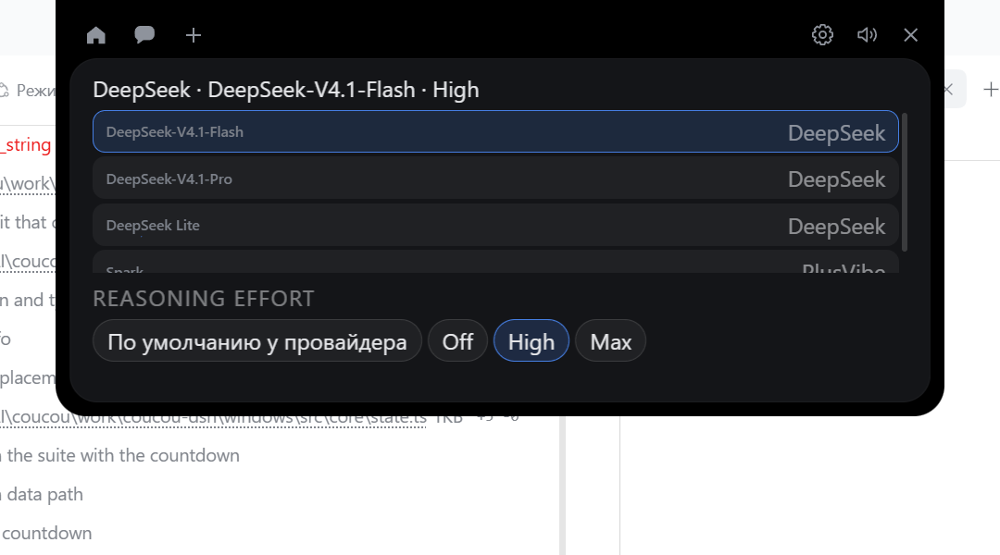
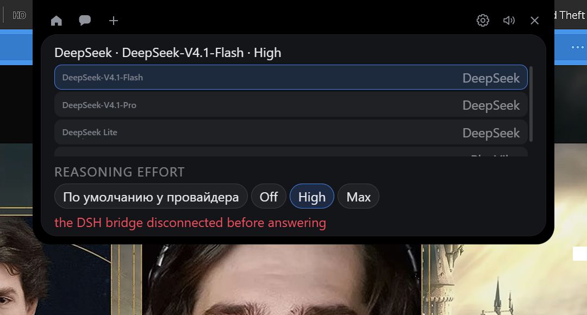
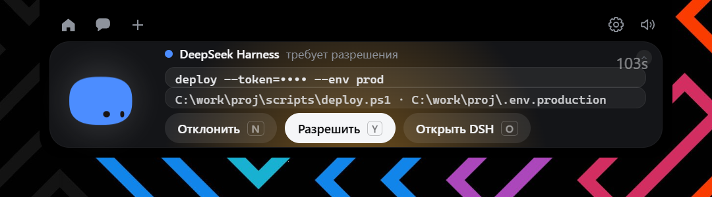

# Приоритет 3, подэтап Г: переключение модели и reasoning effort

**Дата:** 2026-11-12  
**Статус:** реализовано, проверено на стенде с двумя сессиями.

## 1. Что выяснено об API DSH

Читал сам бандл DSH (`resources/app.asar`), а не догадывался:

| Что | Как устроено |
|---|---|
| Выбор модели | `agent.model.select({provider, model, reasoningEffort?})` — интерфейс `Model` в DSH |
| Чтение выбора | `agent.model.current()` — возвращает записанный выбор или живой маршрут |
| Хранение | проекция `modelSelection` (`stateVersion: 3`) с полями `lastUsed` и `pending` |
| Смысл полей | `lastUsed` — что ушло в **прошлый** запрос; `pending` — что уйдёт в **следующий** |
| Переход | при `request/header` `pending` становится `lastUsed`, если совпало |

Отсюда главное правило подэтапа: **изменение применяется к следующему запросу**, а не к
выполняющемуся. Комментарий в самом DSH: «Session selection fold: recorded selections
become the pending choice, and each request header retires a matching one».

Усилия модели DSH отдаёт через `llm.resolveModelInfo(...).reasoning.efforts`, и они
принадлежат **конкретной модели**, а не провайдеру.

## 2. Что сделано

| Файл | Изменение |
|---|---|
| `src-tauri/src/dsh/client.rs` | реестр запросов, событие `dsh-config`, `dsh_set_config` возвращает id |
| `src/core/dsh.ts` | `modelChoices`, `choiceFor`, `effortsFor`, `isKnownModel`, `isKnownEffort`, `selectionLine`, `appliesToNextRequest` |
| `src/island/dsh.ts` | `DshConfig`, `chooseModel`, `chooseEffort`, таймаут, обработка ответа |
| `src/views/model.ts` | новый вид-пикер: список моделей и чипы усилий |
| `src/core/layout.ts` | вид `model`, высота 300 |
| `src/views/views.ts` | регистрация вида, `openModelPicker` |
| `src/island/island.ts` | ↗ на пилюле DSH открывает пикер |
| `src/style.css` | стили пикера |
| `src/i18n/extra.json` | 7 новых строк на 14 языках |

**Ни одна модель не захардкожена.** Всё, что видно в пикере, приходит из каталога DSH.

## 3. Найденные и исправленные дефекты

Все три найдены живым прогоном, а не рассуждением.

### 3.1 Пилюля DSH исчезала после перезагрузки настроек

`State.loadIntegrationTasks()` оставляет только пилюли, объявленные пользователем. DSH
не объявлен — он появляется потому, что жив bridge. После любого обновления настроек
пилюля удалялась и не возвращалась. Добавлен `refreshDsh()` после каждого такого
перестроения.

### 3.2 Ответ мог прийти раньше, чем известен его id (Rust)

`dsh_set_config` сначала отправлял кадр и только потом регистрировал запрос. Хост
отвечает в ту же миллисекунду, ответ приходил к неизвестному id и **отбрасывался** —
изменение применялось, а интерфейс показывал «DSH did not answer». Регистрация
перенесена до отправки.

### 3.3 Та же гонка во фронтенде

Событие `dsh-config` могло прийти до того, как промис вернул `requestId`. Добавлено
удержание раннего ответа (`earlyResult`).

## 4. Обязательные испытания

Стенд: подставной мост с **двумя сессиями** и настоящей логикой `session.setConfig`
(применяет и перечитывает, как плагин).

| № | Испытание | Результат |
|---|---|---|
| 1 | Переключение между двумя моделями | `model=deepseek/v4-pro` → применено |
| 2 | Изменение effort | `reasoning_effort=high` → применено |
| 3 | Модель с другим набором усилий | `plusvibe/spark` — у неё Low/Medium, без Off/High/Max |
| 4 | Effort этой модели | `reasoning_effort=medium` → применено |
| 5 | Возврат к исходной модели | `deepseek/v4-flash` → применено |
| 6 | Две сессии существуют | 2 сессии в снимке |
| 7 | Вторая сессия не изменилась | все 5 изменений ушли в `s-fake`, в `s-second` — **0** |
| 8 | Глобальные настройки DSH не изменены | `cordis.patch.yml` SHA-256 прежний, файлы профиля не тронуты |
| 9 | Ошибка при неизвестной модели | `invalid_value: unknown model: deepseek/ghost-model` |
| 10 | Отключение Bridge во время операции | «the DSH bridge disconnected before answering», модель осталась Flash |
| 11 | Нет ложного сообщения об успехе | при разрыве значение не изменилось; текст ошибки виден в пикере |

Дополнительно проверено, что мост отвергает и неизвестную сессию
(`unknown_session`), и чужой effort (`unknown reasoning effort for deepseek/v4-flash: medium`).

## 5. Скриншоты



Заголовок показывает подтверждённое состояние: `DeepSeek · DeepSeek-V4.1-Flash · High`.
Список — все модели каталога с провайдером. Чипы — только усилия выбранной модели плюс
«По умолчанию у провайдера».



Разрыв во время операции: красным «the DSH bridge disconnected before answering»,
модель осталась прежней — ничего не применено.

## 6. Дополнительное требование: обратный отсчёт

**Реализовано, протокол не менялся.** `expiresAt` уже приходил в `approval.asked`;
добавлены только поле в `ApprovalInfo`, `setInterval` на карточке и стиль.



Проверено: отсчёт убывает (103 s → 65 s), по достижении нуля **ничего не отправляется**
(`approval.answer` = 0). Механизм безопасности не затронут: таймер только рисует текст.

## 7. Тесты

| Набор | Результат |
|---|---|
| `npm test` | **571 / 571** (22 новых на модели и усилие, 2 на отсчёт) |
| `cargo test dsh::` | **15 / 15** |
| `npx tsc --noEmit` | 0 ошибок |

## 8. Изоляция сессий

Подтверждена дважды: на уровне протокола (все кадры несут `sessionId`, и в журнале
моста у `s-fake` 5 изменений, у `s-second` — 0) и на уровне кода (`chooseModel` и
`chooseEffort` принимают `sessionId` и передают его без изменений; глобальных
переключателей в приложении нет).

## 9. Оставшиеся ограничения

1. **Настоящий агент не проверялся.** Все прогоны — на подставном мосте: в этой
   сессии DSH запросы разрешений отключены, а переключение модели требует живой
   сессии. Протокол совпадает, но живой DSH ещё не подтверждал.
2. **«Применится к следующему запросу»** показывается по состоянию сессии
   (`working`/`thinking`), а не по проекции `lastUsed`/`pending`: плагин её не
   публикует. Точное различение потребовало бы расширения протокола.
3. **Список моделей прокручивается**: при четырёх моделях последняя видна частично.
   Высота ограничена, чтобы остров не закрывал экран.
4. **`Provider default`** всегда в списке усилий: так можно вернуть модели её
   собственное значение по умолчанию. Плагин читает пустую строку как «не задано».

## 10. Git

```
(см. коммит «feat(dsh): model and effort switching»)
```

Оригинальный Coucou не изменён: `settings.json` SHA-256
`6796C2DEE29C043A330377659D8F391D7B23547411B08FF007ED39CE02E86D60`, 22 файла,
автозапуск `Coucou` и `CoucouDshBridge` на месте.