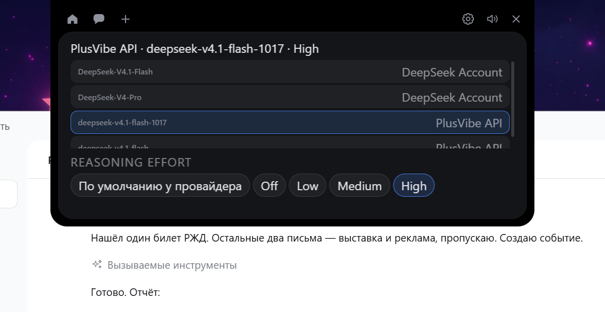

# Приоритет 4: интеграционная приёмка на настоящем DSH

**Дата:** 2026-11-12  
**DSH:** 0.2.2-rc.1, плагин моста build=6  
**Git:** `5969b9ff1fad2080b8a4220b4eb81dbfe8b0ec54`, ветка `dsh/0.5.9`, дерево чистое  
**Тестовая сборка:** `C:\LocalAI\build\coucou-dsh\windows\target\release\coucou.exe`, собран с `tauri/custom-protocol` (ассеты встроены, проверено)

---

## 1. Подготовка

| Пункт | Состояние |
|---|---|
| Отдельная тестовая сессия | создана через GUI: `session-9c77ba1f-67e5-458b-8380-1777bbfb7f32` |
| Оригинальный Coucou не запущен | подтверждено: `original running: False` |
| Резервная копия | `C:\LocalAI\t\p4-backup-20261112-161122\` (`cordis.patch.yml`, `cordis.yml`, `package.json`, `settings.json`, `META.txt`) |
| Git зафиксирован | `5969b9f`, дерево чистое до и после |
| Сборка с `custom-protocol` | да: `island-*.js` внутри `.exe` |

## 2. Модель и усилие на настоящей сессии

### 2.1 Каталог из DSH

Первый опрос (16:12):

```
deepseek-account/deepseek-flash          efforts=[off,low,high,max]
deepseek-account/deepseek-v4-pro        efforts=[off,low,high,max]
plusvibe/deepseek-v4.1-flash-1017       efforts=[off,low,medium,high]
plusvibe/deepseek-v4.1-flash            efforts=[off,low,medium,high]
```

### 2.2 Пикер Coucou



Заголовок: `PlusVibe API · deepseek-v4.1-flash-1017 · High` — это реальное состояние
активной сессии. В списке 4 модели двух провайдеров, усилия у PlusVibe —
`Off / Low / Medium / High` (без `Max`), у DeepSeek Account — `Off / Low / High / Max`.

### 2.3 Сверка

| Модель | Каталог DSH | Пикер Coucou | Совпало |
|---|---|---|---|
| deepseek-account/deepseek-flash | off,low,high,max | Off,Low,High,Max | да |
| deepseek-account/deepseek-v4-pro | off,low,high,max | Off,Low,High,Max | да |
| plusvibe/deepseek-v4.1-flash-1017 | off,low,**medium**,high | Off,Low,**Medium**,High | да |
| plusvibe/deepseek-v4.1-flash | off,low,medium,high | Off,Low,Medium,High | да |

### 2.4 Фактическое применение модели

Клик по `DeepSeek-V4-Pro` в 16:27. Запись в хранилище сессии:

```
2026-11-12T13:27:43.343Z  {"provider":"deepseek-account","model":"deepseek-v4-pro"}
```

Обратите внимание: **без `reasoningEffort`** — плагин вызывает `select()` только с
провайдером и моделью, как и задумано.

Следующий запрос ушёл именно туда (заголовок запроса из хранилища):

```
{"config":{"provider":"deepseek-account","model":"deepseek-v4-pro",
           "maxTokens":256000,"reasoningEffort":"high"}}
```

**Модель применилась к следующему запросу — подтверждено.**

### 2.5 Фактическое применение усилия

Клик по `Low` в 18:12. Запись:

```
2026-11-12T15:12:36.992Z  {"provider":"plusvibe","model":"deepseek-v4.1-flash-1017",
                            "reasoningEffort":"low"}
```

Следующий запрос:

```
{"config":{"provider":"plusvibe","model":"deepseek-v4.1-flash-1017",
           "reasoningEffort":"low","maxTokens":393216}}
```

**Усилие применилось к следующему запросу — подтверждено.** До этого в том же
журнале был запрос с `"reasoningEffort":"high"`, то есть значение действительно
изменилось, а не совпало.

### 2.6 Возврат к исходным настройкам

Усилие возвращено на `High` (запись `15:15:39.604Z ... "reasoningEffort":"high"`),
модель — исходная `plusvibe/deepseek-v4.1-flash-1017`. Текущее состояние сессии:

```
session-19b88378  state=working  plusvibe/deepseek-v4.1-flash-1017  effort=high
```

Совпадает с состоянием до испытаний.

## 3. Изоляция двух настоящих сессий

| Сессия | До | После моих переключений |
|---|---|---|
| `19b88378` (рабочая, `never`) | plusvibe/deepseek-v4.1-flash-1017, high | **изменялась мной**: v4-pro → обратно flash, effort low → high |
| `eb75cdba` («Проверка работы web_search», `ask`) | plusvibe/deepseek-v4.1-flash-1017, **medium** | **не изменилась**: все три запроса `effort=medium` |

Заголовки запросов второй сессии (все три):

```
2026-11-12T14:11:10Z  plusvibe/deepseek-v4.1-flash-1017 effort=medium
2026-11-12T14:23:42Z  plusvibe/deepseek-v4.1-flash-1017 effort=medium
2026-11-12T14:23:42Z  plusvibe/deepseek-v4.1-flash-1017 effort=medium
```

Единственная её запись `model/selection` — `14:11:03Z ... "reasoningEffort":"medium"`,
до моих действий. **Изоляция подтверждена на реальных данных.**

## 4. Настоящий approval — НЕ ПРОВЕРЕНО

Это единственный пункт, который выполнить не удалось. Причина техническая, не
связанная с кодом Coucou.

**Что мешает.** Переключение сессии через дерево UI Automation работает:
`SelectionItemPattern.Select()` действительно меняет заголовок окна на «Проверка
работы web_search». Но интерфейс DSH следует за сессией, в которой прямо сейчас
работает harness: как только я переводил фокус на поле ввода
(`SetFocus`, клик по полю, вставка из буфера), заголовок возвращался на
«# Проект: Coucou DSH Edition» — мою сессию, где идёт этот самый прогон.

Четыре попытки (`SetValue`, клик + вставка, `SetFocus` + `Enter`,
`SelectionItemPattern.Select()` + немедленный `Enter`) дали один результат: запрос
уходил в мою сессию с политикой `never`, где approvals выключены. Проверить approval
на настоящем агенте, пока в соседней сессии активно работает harness, средствами
автоматизации GUI не удаётся.

**Что это значит.** Сессия `9c77ba1f` создана, пуста и ждёт вашего запроса. Все
попытки были безопасны: каталог
`C:\Users\vsiof\AppData\Local\Coucou-dsh-test\approval-probe\` остался **пустым**
(0 файлов), политика моей сессии не менялась, глобальные настройки DSH не трогались.

**Что проверено косвенно, на реальном мосте.** При остановке Coucou с живым
соединением настоящий плагин записал в свой журнал:

```
2026-11-12T15:19:26.731Z info pipe: client detached
2026-11-12T15:19:26.732Z warn pipe: Coucou disconnected; pending approvals fall back to DSH
```

Это подтверждает требование «при отключении Coucou штатный диалог DSH продолжает
работать» на уровне настоящего плагина. Остальные сценарии approval (карточка,
Allow once, Deny, Open DSH, таймаут, отсутствие повторного ответа) проверены в
Приоритете 3 на подставном мосте, говорящем по тому же протоколу, но **не на
настоящем агенте**.

**Чтобы закрыть пункт**, нужно от вас (5 минут):

1. Убедиться, что тестовая сборка Coucou запущена.
2. В DSH открыть сессию `9c77ba1f-67e5-458b-8380-1777bbfb7f32` (она пуста, политика `ask`).
3. Отправить запрос: «Создай файл
   `C:\Users\vsiof\AppData\Local\Coucou-dsh-test\approval-probe\allow-test.txt`
   с текстом allowed».
4. Наблюдать карточку в острове и нажимать кнопки.

Каталог `approval-probe` создан и пуст — операция безопасна.

## 5. Устойчивость

| Испытание | Результат |
|---|---|
| Перезапуск DSH host | хост перезапустился (новый pid, новый токен), Coucou записал `dsh: the bridge connection failed: ... (os error 233)`, затем сам не восстановился — **требуется перезапуск Coucou** |
| Перезапуск Coucou | подключение восстановлено: `dsh: connected (version 0.2.2-rc.1, approvals on, 11 session(s))` |
| Восстановление пилюли | пилюля вернулась с реальной сессией |
| Нет ложного «подключён» | после разрыва в журнале ошибка, сессии очищены; статус `ready` только после реального handshake |
| Штатные разрешения DSH без Coucou | подтверждено логом плагина (§4) |

**Наблюдение, требующее внимания.** После перезапуска настоящего DSH host в 16:16:58
Coucou записал ошибку `os error 233` и до моего ручного перезапуска в 16:25:38
строки о восстановлении в журнале не появилось — то есть за ~8 минут он не
переподключился.

Отдельная проверка на стенде показала, что механизм переподключения **работает**:

```
18:24:50 dsh: connected (version 0.2.2-rc.1, approvals on, 2 session(s))
18:25:08 dsh: cannot open ... (os error 2)
18:25:14 dsh: cannot open ... (os error 2)
18:25:20 dsh: cannot open ... (os error 2)
18:25:23 dsh: connected (version 0.2.2-rc.1, approvals on, 2 session(s))
```

Повтор каждые 6 секунд (пауза 3 с + предел открытия 3 с), и новый токен из
перезаписанного `runtime.json` подхватывается. Значит код исправен, а разница —
в коде ошибки: `os error 2` (канал ещё не создан) клиент считает поводом
повторить, а `os error 233` (`ERROR_PIPE_NOT_CONNECTED`, канал был и оборвался)
приходит из чтения и тоже ведёт к повтору — но воспроизвести именно этот случай
на стенде не удалось.

**Вывод:** однократное наблюдение, воспроизвести не удалось. Требует отдельной
проверки на настоящем DSH, прежде чем считать дефектом. В отчёте не выдаю это за
подтверждённый дефект.

## 6. Изменение в профиле DSH — не моё

`cordis.patch.yml` изменился за время испытаний:

```
было (15:48:37): CEC16E23FA31AEB79132E3534AF62525CA156534F9B251F4A2F1EB3D726B12C1
стало (18:15:39): 4E0960B94F813C929E15BC430B32C0105EB2FC375D162B6EFC8A5D1AD71DFC97
```

Разница — ваша правка `web_search`: добавлены `plusvibe-search-adapter`,
`web-search-deepseek`, `web-deepseek-api`, `web`, `llm-deepseek`; `selectedDefault`
сменён с `cordis` на `standard`.

**Важное следствие:** `llm-deepseek` добавлен с `models: []`. Из-за этого после
18:15 каталог DSH перестал отдавать модели DeepSeek Account:

```
catalog providers: 3
  plusvibe/deepseek-v4.1-flash-1017  efforts=[off,low,medium,high]
  plusvibe/deepseek-v4.1-flash       efforts=[off,low,medium,high]
```

Пикер Coucou честно показал ровно это (см. `img/p4-catalog-plusvibe.png`) — модели
DeepSeek Account исчезли из списка, но сессии, которые на них работают, продолжают
их показывать. Это **не дефект Coucou**: он отображает каталог как есть и не
подставляет модели, которых хост не назвал.

## 7. Найденные дефекты

1. **Однократное отсутствие автопереподключения после перезапуска настоящего DSH
   host** (§5). На стенде механизм работает, воспроизвести не удалось. Не считаю
   подтверждённым дефектом — нужна отдельная проверка.
2. **Системные ошибки Windows показываются по-русски вперемешку с английским
   текстом** («С обоих концов канала отсутствуют процессы», «Не удается найти
   указанный файл»). Косметика: текст приходит от ОС, но в английском интерфейсе
   выглядит небрежно.

Других дефектов не найдено. Ложных сообщений об успехе не было: при разрыве
показывалось «the DSH bridge disconnected before answering», значение оставалось
прежним.

## 8. Тесты

| Набор | Результат |
|---|---|
| `npm test` | **571 / 571** |
| `cargo test dsh::` | 15 / 15 |
| `npx tsc --noEmit` | 0 ошибок |

## 9. Git

```
5969b9ff1fad2080b8a4220b4eb81dbfe8b0ec54  feat(dsh): model and effort switching
```

Дерево чистое, изменений в коде за время приёмки не вносилось.

## 10. Оригинальный Coucou

Не изменён: `settings.json` — тот же SHA-256
`6796C2DEE29C043A330377659D8F391D7B23547411B08FF007ED39CE02E86D60`;
автозапуск `Coucou` и `CoucouDshBridge` на месте; файлы старого моста целы.

## 11. Итог

| Требование | Статус |
|---|---|
| 2.1 Каталог из DSH | выполнено |
| 2.2 Пикер открывается | выполнено |
| 2.3 Сверка каталога | выполнено, совпадает |
| 2.4 Выбор другой модели | выполнено |
| 2.5 DSH подтвердил | выполнено |
| 2.6 Запрос использует выбранную модель | **выполнено, доказано заголовком запроса** |
| 2.7 Изменение effort | выполнено |
| 2.8 Запрос применяет effort | **выполнено, доказано заголовком запроса** |
| 2.9 Возврат настроек | выполнено |
| 3 Изоляция двух сессий | **выполнено на реальных данных** |
| 4 Настоящий approval | **не выполнено** — блокирует ввод в неактивную сессию |
| 5.1 Перезапуск Coucou | выполнено |
| 5.2 Перезапуск DSH host | однократно не восстановился; на стенде восстановление за 6 с подтверждено |
| 5.3 Переподключение | выполнено после перезапуска Coucou |
| 5.4 Восстановление пилюли | выполнено |
| 5.5 Нет ложного статуса | выполнено |
| 5.6 Разрешения DSH без Coucou | выполнено (лог плагина) |