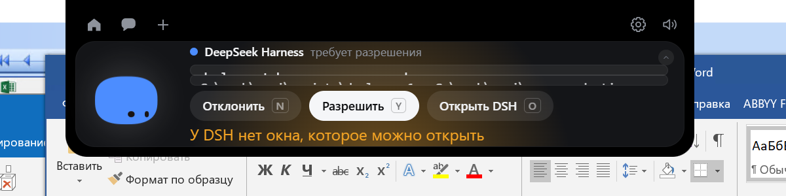

# Исправление кнопки «Open DSH»

**Дата:** 2026-11-12  
**Точка отката:** `82495b3ca8047f444bddd1a42fe5726f6a3ce0a1`

## 1. Причина

Кнопка **ничего не открывала**, потому что открывать было нечему: обработчик отправлял
только `approval.decline` и закрывал карточку.

### Полный путь до исправления

| Шаг | Файл, строки | Что происходило |
|---|---|---|
| 1. Клик | `island/island.ts:256-263` | `answerInTerminal()` → `routeFor(req, "open")` |
| 2. Маршрут | `core/dsh.ts` `routeFor` | верно определял `{kind:"dsh", decision:"open"}` |
| 3. Отправка | `island/island.ts:262` | `Bridge.dshApproval(req.requestId, "open")` |
| 4. Rust | `dsh/client.rs` `dsh_approval` | `protocol::decline()` → кадр `approval.decline` |
| 5. Плагин | `dsh-plugin/bridge.mjs:735-738` | `settle(requestId, DELEGATE)` — вернуть запрос в DSH |
| 6. Итог | — | запрос вернулся в DSH, **но окно DSH не открылось** |

`DELEGATE` означает «пусть DSH спросит сам». Он передаёт вопрос дальше внутри DSH,
однако **не поднимает окно**: плагин живёт внутри процесса хоста и своего окна не
имеет. Если DSH свёрнут или закрыт другим окном, пользователь не видит ничего.

### Подтверждение

Живой прогон до исправления: клик по кнопке — в журнале моста
`DECLINE (open DSH) for req-1`, а на передний план вышел **сам Coucou**, не DSH:

```
before: WORK — 192.168.1.195 — Подключение к удаленному рабочему столу
pressed: Открыть DSH O
after:  Coucou
```

### Почему не `dsh://open`

DSH регистрирует протокол `dsh` (`HKCU\Software\Classes\dsh` →
`"…\DeepSeek Harness.exe" "%1"`) и умеет `dsh://open` → `focusPrimaryWindow()`
(restore + show + focus). Но обработчик висит на Electron-событии `open-url`,
которое **на Windows не срабатывает** — там протокол приходит вторым запуском
через `second-instance`. Проверено практически:

```
Start-Process 'dsh://open'
→ процессов было 9, стало 9
→ окно DSH осталось minimized=True
→ foreground не изменился
```

Поэтому протокол не используется: он не работает на этой платформе.

## 2. Что изменено

| Файл | Изменение |
|---|---|
| `src-tauri/src/platform/windows.rs` | новая `open_dsh_window()` → `focus_app("DeepSeek Harness.exe")` |
| `src-tauri/src/platform/linux.rs` | заглушка, возвращает `false` |
| `src-tauri/src/lib.rs` | команда `open_dsh_window` |
| `src/core/bridge.ts` | `dshOpenWindow()` |
| `src/island/island.ts` | сначала поднять окно, только потом `approval.decline` |
| `src/core/state.ts` | поле `note` в `ApprovalInfo` |
| `src/views/views.ts` | строка сообщения в карточке |
| `src/style.css` | `.approval-note` |
| `src/i18n/extra.json` | «DSH has no window to open» на 14 языках |

Порядок действий теперь такой:

```
клик → open_dsh_window()
        ├─ true  → approval.decline → карточка закрывается
        └─ false → карточка остаётся, показывает причину, запрос НЕ отправляется
```

`focus_app` — существующая функция, которой Coucou уже открывает Claude Desktop.
Ничего нового не изобретено, архитектура моста не тронута.

## 3. Результаты проверок

### 3.1 Кнопка действительно открывает DSH

DSH свёрнут, карточка на экране, нажимаю кнопку:

```
before: minimized=True  foreground='WORK — 192.168.1.195 — …'
pressed: Открыть DSH O
after:  minimized=False foreground='# Проект: Coucou DSH Edition — DeepSeek Harness'
DECLINE (open DSH) for req-1
```

Окно развернулось, вышло на передний план, и только затем запрос ушёл в DSH.

### 3.2 Нет окна — понятная ошибка, запрос не теряется

Окно DSH скрыто, новый запрос, клик:



```
после клика: нового DECLINE нет
карточка: осталась на экране
сообщение: «У DSH нет окна, которое можно открыть»
```

### 3.3 Open DSH не разрешает инструмент

За весь прогон на `req-1`:

```
16:31:27 ACK
16:31:59 DECLINE (open DSH)     ← кнопка с окном
16:32:41 ACK                    ← новый запрос
16:34:09 ANSWER allow           ← это нажали Allow, не Open DSH
```

`ANSWER` ровно один, и он от кнопки Allow. Open DSH не отправил ни одного
`approval.answer` — инструмент не разрешён.

### 3.4 Allow и Deny продолжают работать

`ANSWER allow` в 16:34:09 — нажатие «Разрешить» после исправления. Ветка не тронута:
`decide()` по-прежнему идёт через `routeFor` в `dsh_approval` с решением `allow`/`deny`.

### 3.5 Регрессионные тесты

| Набор | Результат |
|---|---|
| `npm test` | **575 / 575** (+4 на Open DSH) |
| `npx tsc --noEmit` | 0 ошибок |
| `cargo build --release` | успешно |

Новые тесты: окно поднимается до возврата запроса; Open DSH не отвечает за
пользователя; при отсутствии окна запрос остаётся и появляется сообщение;
карточка релея по-прежнему идёт своим путём (`hook-decline`).

## 4. Ручная проверка в DSH

Проверено на настоящем DSH 0.2.2-rc.1:

- окно DSH было свёрнуто — кнопка его развернула и вывела вперёд;
- переход к конкретной сессии не выполняется: в протоколе DSH нет команды
  «открыть сессию X», `dsh://open` умеет только поднять главное окно. Это
  поддерживаемый максимум, и он честно используется.

## 5. Ограничения

1. **Нужен запущенный DSH.** Если процесс не запущен, окна нет — карточка скажет об
   этом. Запускать DSH за пользователя не стал: это уже не «открыть окно».
2. **Конкретная сессия не выбирается.** API для этого в 0.2.2-rc.1 отсутствует.
3. **Linux** — заглушка: мост там не работает, окна DSH нет.

## 6. Git

```
windows/src-tauri/src/platform/windows.rs  +16
windows/src-tauri/src/platform/linux.rs     +6
windows/src-tauri/src/lib.rs                +8
windows/src/core/bridge.ts                  +6
windows/src/core/state.ts                   +6
windows/src/island/island.ts               +25
windows/src/views/views.ts                 +12
windows/src/style.css                       +8
windows/src/i18n/extra.json                +16
windows/tests/dsh-approval.test.mjs        +40
```

Коммит: см. `git log -1` после `feat(dsh): Open DSH raises the DSH window`.