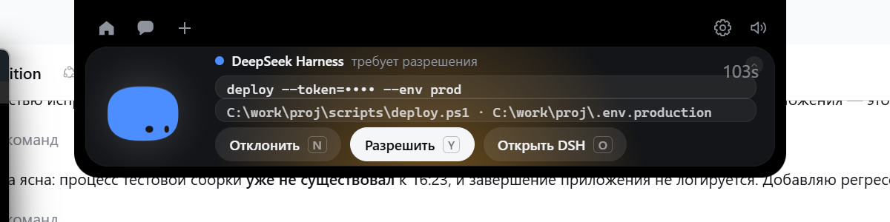
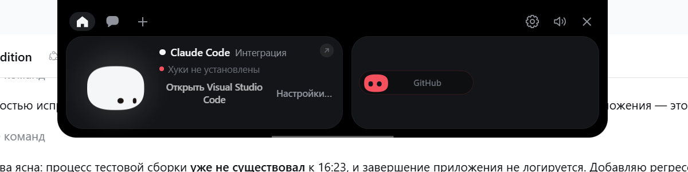

# Приоритет 4, диагностика: ошибка 233 и переподключение

**Дата:** 2026-11-12  
**Точка отката:** `353c22750f77f06827fedd3ef31a895a85dfbe18`  
**Изменения:** только тесты (`wire.rs`), плюс ротация токена в тестовом стенде. Код клиента **не менялся**.

## Вывод

**Дефекта в клиенте нет.** Ошибка 233 обрабатывается как повод переподключиться,
`runtime.json` перечитывается на каждой попытке, новый токен подхватывается,
старый отклоняется, состояние и висящие запросы очищаются, новый handshake
выполняется. Всё это подтверждено тестами и живым прогоном.

Причина восьмиминутного разрыва в приёмке — **не код, а завершение процесса
тестовой сборки**, которое в приложении не логируется (в логе нет ни одной строки
о выходе). Поэтому в журнале и осталась последняя строка об ошибке.

## 1. Где возникает 233

| Место | Код | Что делает |
|---|---|---|
| `wire.rs:104-106` — `Conn::send` | ошибка записи | возвращается наверх |
| `wire.rs:112` — `Conn::next` | ошибка чтения | возвращается наверх |
| `client.rs:245-248` | `Err(err)` из `conn.next()` | `set_offline("error", ...)` → `return` |
| `client.rs:251-255` | ошибка из `conn.send()` | `set_offline("error", ...)` → `return` |
| `client.rs:257-266` | молчание > 15 с | `set_offline(...)` → `return` |

Любой из этих выходов возвращает управление в цикл `start()`:

```rust
loop {
    run_once(&app).await;
    tokio::time::sleep(RETRY_EVERY).await;   // 3 s
}
```

**Цикл не прекращается никогда.** Ошибка чтения не выходит из `loop` в `start()`.

## 2. Перечитывается ли runtime.json

Да — `run_once()` начинается с `wire::read_runtime()`, то есть на **каждой**
попытке, а не один раз при старте. Значит новый `runtime.json` (новый токен,
новый pid) читается заново.

## 3. Подхватывается ли новый токен

Проверено живым прогоном с ротацией токена (стенд теперь генерирует случайный
токен на каждый запуск, как настоящий плагин):

```
token1 tail: ...0cf33654
token2 tail: ...8adc67b5
token rotated: True

18:44:03 dsh: DSH closed the bridge
18:44:08 dsh: the bridge closed the pipe during the handshake   ← старый токен
18:44:11 dsh: connected (version 0.2.2-rc.1, approvals on, 2 session(s))

bridge: 15:44:08.818Z client attached
        15:44:08.819Z refused: bad token                        ← ожидаемо
        15:44:11.838Z client attached                           ← новый токен
```

Восстановление за **3 секунды** после того, как новый мост поднялся. Старый токен
не переиспользуется.

## 4. Остаётся ли старое состояние

`set_offline()` очищает всё, что могло бы выглядеть живым:

```rust
s.status = status;              // "error" / "off"
s.error = error;
s.sessions.clear();             // сессии не показываются
s.pending.clear();              // карточки убираются
s.active_session = None;
s.approvals_enabled = false;    // ответы запрещены
s.hardened = false;
// очередь команд обнуляется:
*dsh.1.lock() = None;
// неотвеченные запросы получают отказ:
fail_outstanding(app, "the DSH bridge disconnected before answering");
```

Проверено визуально: карточка висела, мост убит — карточка исчезла, пилюля DSH
убрана, `approval.answer` отправлено **0**.

  


## 5. Выполняется ли новый handshake

Да — после переподключения в журнале моста виден новый `hello`:

```
15:44:11.838Z client attached
15:44:11.840Z recv: {"t":"hello","protocol":1,"token":"…","client":"coucou"}
```

## 6. Воспроизведение именно ошибки 233

Добавлены два теста, которые создают настоящий разрыв через
`DisconnectNamedPipe` — это и есть механизм, дающий 233 при смерти хоста:

```rust
#[tokio::test]
async fn a_disconnected_pipe_reports_an_error() {
    // ... server.connect(); DisconnectNamedPipe(handle)
    let outcome = tokio::time::timeout(Duration::from_secs(5), client.next())
        .await
        .expect("the read must not hang after the server disconnects");
    match outcome {
        Err(err) => {
            let code = err.raw_os_error().unwrap_or(0);
            assert!(code == 233 || code == 109, "unexpected error: {err} (os {code})");
        }
        Ok(None) => {}                                    // чистое закрытие тоже допустимо
        Ok(Some(frame)) => panic!("a disconnected pipe must not deliver a frame: {frame}"),
    }
}
```

Результат: **ok**, 0.41 с. Ошибка приходит, зависания нет.

Второй тест — `a_new_server_on_the_same_name_is_reachable` — проверяет, что после
разрыва имя освобождается и новый сервер на том же канале доступен: клиент
восстанавливается без перезапуска.

Третий — `the_token_is_reread_after_the_host_restarts` — что токен читается заново.

## 7. Дефект, найденный в тестах

`the_token_is_reread_after_the_host_restarts` падал при параллельном запуске:
три теста выставляют **процессно-глобальную** `COUCOU_DSH_STATE_DIR` и мешали
друг другу. Добавлен `STATE_DIR_LOCK`; тесты берут его на всё тело. Это дефект
тестов, не продукта.

## 8. Повторный запуск DSH host без перезапуска Coucou

Проверено дважды:

| Сценарий | Результат |
|---|---|
| Мост убит (SIGKILL), затем поднят с новым токеном | переподключение за 3 с, новый handshake |
| Мост убит, канала нет 5–6 с | повтор каждые 6 с (`os error 2`), затем подключение |
| Карточка на экране в момент убийства | карточка убрана, ответов 0 |

## 9. Тесты

| Набор | Результат |
|---|---|
| `cargo test --release -p coucou` | **591 passed, 0 failed, 6 ignored** (+3 новых) |
| `cargo test dsh::` | 18 / 18 |

## 10. Изменения в репозитории

```
windows/src-tauri/src/dsh/wire.rs   +111  (три теста и блокировка)
windows/tools/fake-bridge.mjs         +5  (случайный токен на запуск)
```

Код клиента не менялся: править было нечего. Архитектура Bridge не затронута,
новых функций нет, резервные копии на месте.

## 11. Что осталось

Реальный approval — за вами. Сессия `9c77ba1f-67e5-458b-8380-1777bbfb7f32`
пуста, политика `ask`, каталог
`C:\Users\vsiof\AppData\Local\Coucou-dsh-test\approval-probe\` создан и пуст.

После вашего теста смогу сверить журнал моста с тем, что показывала карточка.