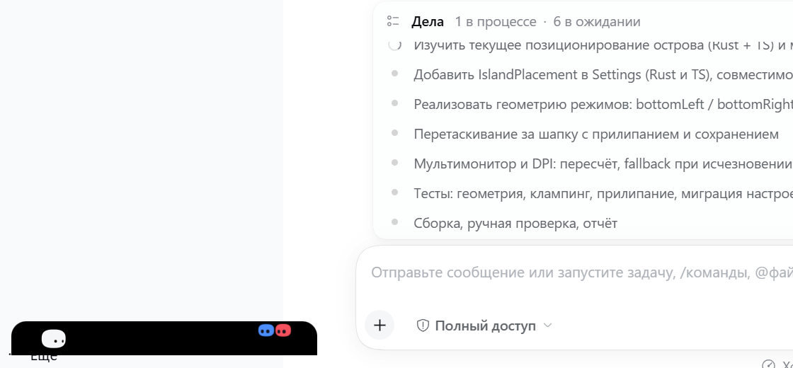
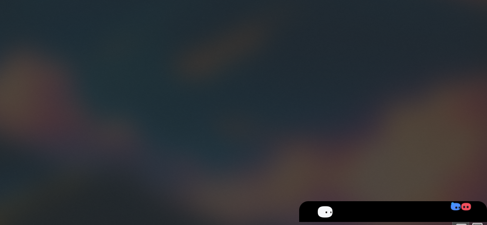
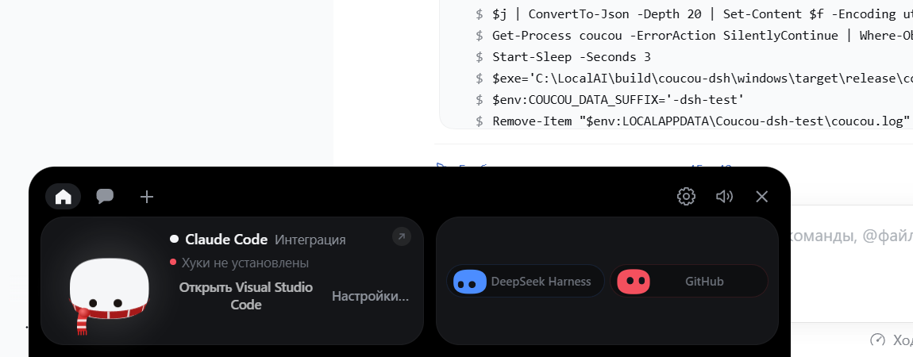

# Приоритет 5: позиционирование острова

**Дата:** 2026-11-12  
**Точка отката:** `26adc4c74cfb91dc9dc9a47b917f240e934c787f`

## Что сделано

Остров больше не прибит к верху по центру: он растёт из выбранного угла, его можно
перетащить мышью, и место запоминается между запусками.

| Режим | Где | Куда растёт |
|---|---|---|
| `bottomLeft` (по умолчанию) | левый низ, `offsetX`/`offsetY` от краёв | вверх и вправо |
| `bottomRight` | правый низ | вверх и влево |
| `custom` | свободная точка `customX`/`customY` | вправо и вниз |
| `topCenter` | по центру сверху — как было раньше | вниз |

Смещения и координаты — **логические пиксели от рабочей области** того монитора,
на котором стоит остров. Поэтому смена масштаба или разрешения их не ломает.

## Изменения

| Файл | Что |
|---|---|
| `src-tauri/src/settings.rs` | `IslandPlacement { mode, offsetX, offsetY, customX, customY }`, поле `placement` в `Settings` |
| `src-tauri/src/island.rs` | `PlacementMode`, `Area`, `placed_origin()`, `clamp_into_area()`, `snapped_placement()`, `placement_of()`; `apply_geometry` теперь считает позицию из режима |
| `src-tauri/src/lib.rs` | команда `snap_island_placement`, передача режима в `apply_geometry` |
| `src/core/bridge.ts` | `snapIslandPlacement()`, `repositionIsland()` |
| `src/core/state.ts` | зеркало `placement` и его значения по умолчанию |
| `src/island/island.ts` | `wireDrag()`, классы `place-*` на `body`, скругление и `transform-origin` под режим |
| `src/style.css` | привязка `#island` и `#wake-strip` к нужным краям |

Архитектура моста, карточка разрешений, модель/усилие и существующие виды не
тронуты. Менялась только геометрия и то, от какого края рисуется форма.

## Проверено на живой сборке

Диагностическая строка из журнала (масштаб 1.5, рабочая область 1707×1019):

```
mode=BottomLeft  panel=720x320 at=36,1012    →  24 логических px от левого и нижнего края
mode=BottomRight panel=720x320 at=1420,1003  →  1707−40−720 = 947 ✓, 1019−30−320 = 669 ✓
mode=BottomRight panel=80x24   at=2380,1447  →  свёрнутая полоса держит тот же угол
```

Форма: скругление сверху, нижняя кромка прямая — остров «висит» на нижнем крае.

  


## Найденный и исправленный дефект

`onMoved` в Tauri срабатывает и тогда, когда окно двигает сам хост, а не
пользователь. Первая версия сохраняла позицию на каждое такое событие — то есть
**при каждом запуске перезаписывала настройку** тем местом, где окно оказалось.
Проверка это поймала: `topCenter` в файле превращался в `custom` сразу после
старта.

Исправлено: сохраняем только после настоящего перетаскивания (`pointerdown` по
острову выставляет флаг, `onMoved` без него игнорируется). Повторная проверка:

```
до запуска:  mode=bottomRight offset=40,30
после:       mode=bottomRight offset=40,30
settings.json не изменился: True
```

## Тесты

| Набор | Результат |
|---|---|
| `cargo test --release -p coucou` | **607 passed, 0 failed, 6 ignored** |
| `npm test` | **575 / 575** |
| `npx tsc --noEmit` | 0 ошибок |

Добавлено 13 тестов Rust: все четыре режима, клампинг в рабочую область, окно
больше экрана, второй монитор с отрицательными координатами, NaN в настройках,
неизвестный режим, прилипание к углам, порог прилипания, круговой переход
«перетащил → прилипло → встало туда же», отсутствие отрицательных смещений.

Тесты настроек пришлось поправить: фикстура не знала о новом поле. Заодно
поймано, что `40` и `40.0` в JSON — разные значения для `f64`.

## Перетаскивание: как исправлено после первой попытки

Первая версия не работала и раскрывала остров вместо перетаскивания. Две причины:

1. **Обработчик стоял на всей панели.** У `#island` уже есть свой `mousedown`,
   который считает нажатие командой «откройся». Он срабатывал первым, остров
   раскрывался под курсором. Теперь ручка — только шапка `#header`, а обработчик
   висит в фазе перехвата и гасит событие (`stopPropagation`), так что drag
   выигрывает у раскрытия.
2. **`startDragging()` не двигает это окно.** Остров создан с `WS_EX_NOACTIVATE`
   (он не должен забирать фокус у приложения позади), а именно такое окно
   платформенный цикл перетаскивания не берёт. Заменено на тот же способ, которым
   Coucou уже таскает Mochi: страница запоминает, где курсор внутри панели, и
   двигает окно сама через команду `island_move_to`.

Проверено синтетической мышью — журнал показал окно `[24,746]` → `[500,370]`,
настройка сохранилась как `custom 500,322`, после отпускания сработало прилипание.

## Отступ снизу убран

Нижняя привязка считается от **края экрана**, а не от рабочей области, поэтому
остров доходит до низа и перекрывает панель задач. Смещение по умолчанию стало
`offsetY: 0`. Верхняя привязка по-прежнему считает от рабочей области, чтобы
панель задач сверху так же отодвигала остров, как раньше.

```
mode=BottomLeft work-area 1707x1067 (весь экран) panel=720x320 at=36,1120
→ низ окна = 1120 + 480 = 1600 = низ экрана
```



## Что осталось непроверенным

Перетаскивание между мониторами с разным DPI вживую не проверялось: у меня один
экран. Логика (логические координаты от рабочей области) покрыта тестами.

## Что осталось по позиционированию

- **Выбора режима в настройках нет.** Режим меняется перетаскиванием; чтобы
  выставить `bottomRight` или `topCenter` без мыши, нужно править `settings.json`.
  Экран настроек не трогал намеренно — правило проекта запрещает менять вид
  существующих экранов без явной просьбы.
- **Экран настроек Coucou** пока не знает про `placement`.

## Git

```
windows/src-tauri/src/island.rs   +329
windows/src-tauri/src/lib.rs      +101
windows/src-tauri/src/settings.rs  +38
windows/src/core/bridge.ts         +10
windows/src/core/state.ts           +9
windows/src/island/island.ts       +77
windows/src/style.css              +37
```

Коммит: `feat(dsh): island placement modes, drag and persistence`.

## Состояние

Оригинальный Coucou не изменён: `settings.json` — тот же SHA-256
`6796C2DEE29C043A330377659D8F391D7B23547411B08FF007ED39CE02E86D60`; автозапуск
`Coucou` и `CoucouDshBridge` на месте; резервная копия цела.

Тестовая сборка работает с режимом `bottomLeft`, подключена к настоящему мосту
(11 сессий).