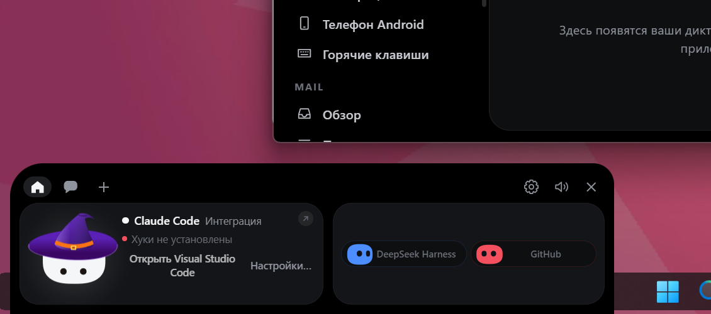
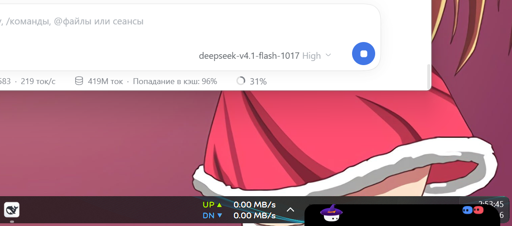
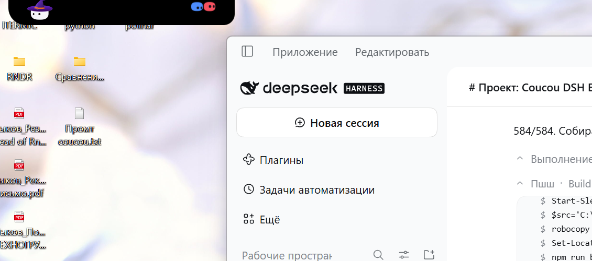

# Приоритет 6: поверх панели задач, ниже полного экрана, гардероб и Мотя

**Дата:** 2026-11-12  
**Точка отката:** `a7a4c3b5be996cf5a96b30733c06cbc5323f796e`

## 1. Гардероб и клики по Моте: одна причина

Оба дефекта — следствие одного промаха.

`islandRect()` в `island/island.ts` остался от прежней раскладки и отвечал
«остров сверху по центру»:

```ts
return { x: (viewportW - w) / 2, y: 0, w, h: hh };   // было
```

После переезда на нижнюю привязку панель стоит **внизу окна**, а попадание по
Моте считалось от верха. Поэтому `isBotHit()` почти всегда возвращал `false`:

- **ПКМ по Моте** не распознавался как клик по нему → обработчик не вызвал
  `toggleWardrobe()`, событие дошло до webview, и Chromium показал своё меню
  («Сохранить как», «Печать»…).
- **ЛКМ по Моте** не распознавался → вместо `engine.slap()` обычный клик уходил
  в `fsm.click()`, а серия таких кликов приводила к `handleDizzy()` →
  «Слишком много ударов» / «Секунду — вернусь к работе через три секунды».

**Исправление:** `islandRect()` теперь возвращает фактическую рамку панели,
сохранённую при раскладке (`this.islandBox`), а не пересчитывает её по-старому.
Гардероб и слэп вернулись сами собой — их код не менялся.

## 2. Поверх панели задач, но не поверх полного экрана

| Что | Как |
|---|---|
| Выше панели задач | окно в полосе topmost (`set_topmost(win, true)`) |
| Ниже полноэкранного приложения | сторож снимает topmost, пока полный экран впереди |
| Выше всех при подтверждении | пока ждёт ответа, topmost включается всегда |

Определение полного экрана — геометрическое (`foreground_box` +
`covers_a_screen`): окно впереди должно накрывать монитор целиком. Развёрнутое
окно останавливается на рабочей области и под условие не попадает, а безрамочное
видео в браузере — попадает. Рабочий стол и оболочка исключены по классу окна.

Сторож (`spawn_topmost_watch`) просыпается дважды в секунду. Он читает состояние
DSH: пока есть `pending`, topmost включается независимо от того, что впереди —
вопрос, которого не видно, всё равно истечёт.

## 3. Скругления по сторонам

Углы, прилегающие к краю, — прямые; свободные скруглены, и угол со стороны
привязки скруглён сильнее (в 1.6 раза), поэтому левая и правая привязки — разные
формы, а не одна и та же.

| Режим | Углы (TL, TR, BR, BL) |
|---|---|
| `bottomLeft`, `taskbarLeft` | 22, 14, 0, 0 |
| `bottomRight`, `taskbarRight` | 14, 22, 0, 0 |
| `topLeft` | 0, 0, 14, 22 |
| `topRight` | 0, 0, 22, 14 |
| `topCenter` | 0, 0, 14, 14 |

Радиус берётся из той же пружины, что и раньше, поэтому скругление продолжает
анимироваться при раскрытии и сворачивании. Логика вынесена в
`src/core/corners.ts` с тестами.

  
  


## 4. Прилипание к трём краям

| Режим | Где | Скругление |
|---|---|---|
| `bottomLeft` / `bottomRight` | низ **экрана**, поверх панели задач | верхние углы |
| `taskbarLeft` / `taskbarRight` | верх **панели задач**, она видна | верхние углы |
| `topLeft` / `topRight` / `topCenter` | верх экрана | нижние углы |

Скругления и `transform-origin` задаются классами `place-up` / `place-down` на
`body` — одна точка правды вместо инлайнового стиля.

## 4. Посреди экрана больше не остаётся

Режим `custom` удалён: `PlacementMode::parse("custom")` теперь читается как
`bottomLeft`. При отпускании остров прилипает **вплотную** к ближайшему краю —
сохраняется только положение вдоль края. Раньше сохранялся и зазор, из-за чего
остров, брошенный в центре, оставался в центре.

## 5. Тесты

| Набор | Результат |
|---|---|
| `cargo test --release -p coucou` | **612 passed, 0 failed, 6 ignored** |
| `npm test` | **575 / 575** |
| `npx tsc --noEmit` | 0 ошибок |

Новые тесты: три края и их стороны, только верхний край растёт вниз, прилипание к
каждому из трёх краёв, «в центре не остаётся», отсутствие отрицательных смещений,
полноэкранное окно накрывает монитор, развёрнутое — нет, второй монитор, пустой
список мониторов.

## 6. Что НЕ проверено

**Визуально не проверено.** Во время проверки сеанс дважды блокировался, снимок
экрана возвращал экран блокировки. По журналу приложение здорово: `dsh: connected`,
раскладка пересчитана (`at=36,1564` для свёрнутой полосы), процесс отвечает,
падений нет за 60 секунд работы сторожа.

Не проверено вживую:

1. что остров действительно выше панели задач;
2. что он уходит под полноэкранное видео;
3. что при подтверждении он всплывает поверх;
4. гардероб по ПКМ и слэп по ЛКМ — исправление промаха попадания логически
   устраняет причину, но кликнуть по Моте я не смог.

## 7. Git

Изменены: `island.rs`, `lib.rs`, `platform/windows.rs`, `platform/linux.rs`,
`island.ts`, `style.css`, `settings.rs`, `state.ts`, `bridge.ts`.